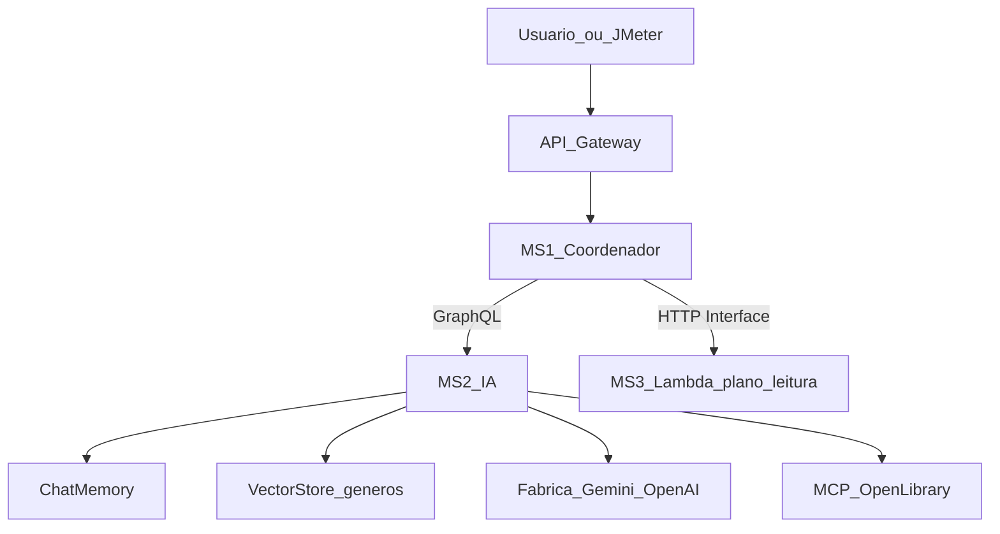

# Como o TP3 funciona (do zero)

Este arquivo existe para uma coisa só: **entender o projeto sem pirar**.

Leia na ordem. Os diagramas abrem no preview do Markdown do Cursor/VS Code / GitHub.

---

## 1. Em uma frase

Você está construindo um **assistente de livros**: o usuário conversa (HTTP → API Gateway → coordenador), a IA recomenda com **memória de conversa**, **RAG de gêneros** e **MCP Open Library**, e uma **Lambda** monta um plano de leitura.

---

## 2. O que este trabalho NÃO é

| Não é | É |
|-------|---|
| UI web elaborada | API HTTP + GraphQL atrás do Gateway |
| Catálogo próprio de livros no banco | Busca real via MCP Open Library |
| MCP servidor escrito por você | Só MCP de **terceiro** (Open Library) |
| Um monólito Spring Boot | Microserviços + Eureka + Config + Vault |

---

## 3. Fluxo feliz (uma pergunta)

Demo: *“Quero ficção científica curta”* → depois *“prefiro menos de 300 páginas, como eu disse”*.



| Peça | Função |
|------|--------|
| **Chat Memory** | Lembra gênero, limite de páginas, já lidos nesta conversa |
| **RAG** | Injeta texto dos arquivos em `docs/corpus/` (o que é cada gênero) |
| **MCP Open Library** | Busca livros/autores reais (sem API key) |
| **Lambda** | Recebe livro escolhido e devolve plano de leitura |

---

## 4. Mapa dos módulos (Maven)

Repo: `ai-powered-web-application/`

```text
ai-powered-web-application/
├── pom.xml                 # parent
├── eureka-server/          # discovery (cluster: 2 peers)
├── config-server/          # configs versionadas no Git
├── api-gateway/            # Spring Cloud Gateway
├── ms-coordenador/         # MS1: orquestra + resiliência
├── ms-ia/                  # MS2: Spring AI + GraphQL
├── ms-lambda/              # código da função serverless
├── config-repo/            # repo Git consumido pelo Config Server
├── docs/                   # esta documentação + corpus RAG
│   └── corpus/             # romance.md, ficcao-cientifica.md, ...
└── jmeter/                 # planos de carga
```

**Não existe** módulo `mcp-server` próprio neste projeto.

---

## 5. Ordem de leitura dos docs

1. [00-visao-geral.md](00-visao-geral.md) — você está aqui
2. [01-plataforma.md](01-plataforma.md) — Eureka, Config, Vault, Gateway
3. [02-ms-coordenador.md](02-ms-coordenador.md) — MS1, GraphQL client, resiliência
4. [03-ms-ia.md](03-ms-ia.md) — Memory, RAG, fábrica LLM, MCP
5. [04-lambda.md](04-lambda.md) — plano de leitura serverless
6. [05-observabilidade-e-carga.md](05-observabilidade-e-carga.md) — métricas, JMeter, knee
7. [06-deploy-aws.md](06-deploy-aws.md) — AWS Academy

---

## 6. Twelve-Factor (checklist rápido)

| Fator | Onde aparece neste projeto |
|-------|----------------------------|
| I. Codebase | Um repo Git; configs em `config-repo` |
| II. Dependencies | Maven (`pom.xml` por módulo) |
| III. Config | Config Server + env vars; segredos no Vault |
| IV. Backing services | Eureka, Vault, LLM APIs, Open Library via MCP, Lambda URL |
| V. Build/release/run | Build Maven; run com perfis/`SPRING_PROFILES_ACTIVE` |
| VI. Processes | Cada microserviço = processo stateless |
| VII. Port binding | Cada app escuta sua porta (Gateway, MS1, MS2, Eureka…) |
| VIII. Concurrency | Várias instâncias registradas no Eureka |
| IX. Disposability | Kill/restart de instância; Chaos Monkey na demo |
| X. Dev/prod parity | Mesma stack local ≈ EC2 Academy |
| XI. Logs | stdout + stack de observabilidade |
| XII. Admin processes | Jobs pontuais (ex.: ingestão RAG no boot do MS2) |

Detalhes de demo na banca: cada doc de escopo tem a seção **“O que a banca pede ver”**.

---

## 7. Contratos em uma página

### Entrada do usuário (via Gateway → MS1)

`POST /api/assistant/chat` (exemplo)

```json
{
  "conversationId": "demo-1",
  "message": "Quero ficção científica curta"
}
```

### MS1 → MS2 (GraphQL)

```graphql
mutation {
  askBookAssistant(conversationId: "demo-1", message: "Quero ficção científica curta") {
    reply
    conversationId
  }
}
```

### MS1 → Lambda (HTTP Interface)

```json
{
  "titulo": "Neuromancer",
  "autor": "William Gibson",
  "paginasEstimadas": 271,
  "diasDisponiveis": 14
}
```

Resposta esperada: plano com `paginasPorDia`, checklist e mensagem.

---

## 8. O que fazer agora

1. Subir a **plataforma** (Eureka cluster + Config + Gateway) — ver [01-plataforma.md](01-plataforma.md)
2. Ligar MS1 ↔ MS2 com GraphQL “hello”
3. Ligar Spring AI (Memory → RAG → MCP)
4. Ligar Lambda e resiliência
5. Observabilidade + JMeter + AWS
