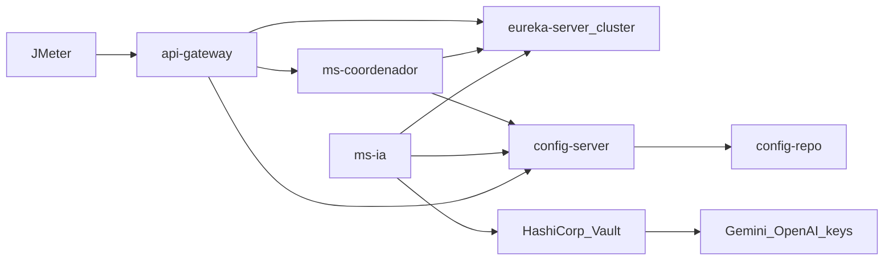
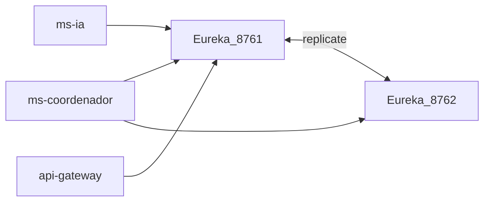
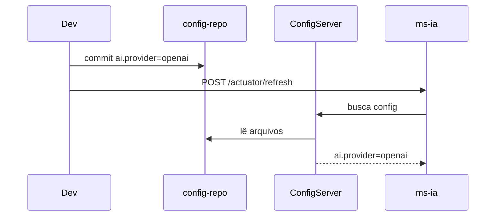
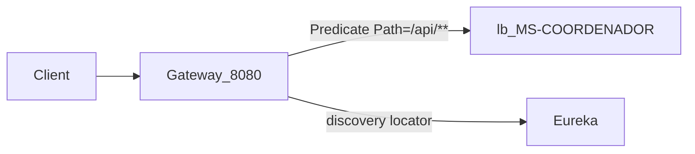

# E1 — Plataforma Spring Cloud

Em uma frase: **antes dos microserviços de negócio, sobe a “estrada”** — descoberta, config, segredos e entrada HTTP.

---

## 1. Peças

| Módulo | Porta típica (dev) | Papel |
|--------|--------------------|-------|
| `eureka-server` (peer A) | 8761 | Registry |
| `eureka-server` (peer B) | 8762 | Segundo peer do cluster |
| `config-server` | 8888 | Config centralizada via Git |
| `api-gateway` | 8080 | Única porta pública para JMeter/cliente |
| Vault | 8200 | Segredos (chaves LLM) |

Open Library MCP **não** precisa de secret no Vault.

---

## 2. Eureka em cluster

A banca pede dashboard Eureka em **modo cluster**.

O que mostrar:

1. Dois processos Eureka com `eureka.client.service-url.defaultZone` apontando um para o outro
2. Dashboard com apps `MS-COORDENADOR`, `MS-IA`, `API-GATEWAY` registrados
3. Derrubar uma instância de MS1 → some do registry → sobe de novo → reaparece

---

## 3. Config Server + Git

- Repo local ou remoto: pasta `config-repo/` neste monorepo (ou Git separado)
- Arquivos típicos: `application.yml`, `ms-coordenador.yml`, `ms-ia.yml`, `api-gateway.yml`
- Propriedade de demo dinâmica: `ai.provider=gemini|openai` (lida pelo MS2)
- Fluxo de alteração dinâmica:

O que a banca pede: alterar valor no Git, refresh, mostrar efeito (troca de provedor LLM ou timeout, etc.).

---

## 4. Vault

Guarda:

- `gemini.api-key` / `spring.ai.openai.api-key` (nomes finais no código)
- Nada de chave Open Library (API pública)

Apps leem via Spring Cloud Vault (Twelve-Factor: config/secrets fora do código).

---

## 5. API Gateway

Responsabilidades:

- Receber HTTP do JMeter na porta 8080
- Rotear `/api/**` → `ms-coordenador` (lb://MS-COORDENADOR)
- Filtros: logging, rate limiter **lado servidor**, correlacionar headers de tracing
- Demo **estática vs dinâmica**:
  - Estática: rotas declaradas em YAML
  - Dinâmica: discovery locator + Eureka

**Boot 4 / Cloud 2025:** starter `spring-cloud-starter-gateway-server-webflux` e prefixo de config `spring.cloud.gateway.server.webflux.*` (não o antigo `spring.cloud.gateway.*`).

---

## 6. O que este escopo NÃO faz

- Não fala com LLM
- Não implementa GraphQL
- Não hospeda a Lambda

---

## 7. O que a banca pede ver

| Item PDF | Como mostrar |
|----------|--------------|
| Eureka cluster | Dois peers + dashboard |
| Gateway estática/dinâmica + filtros/rotas | YAML + locator + request de exemplo |
| Config Server + Git + alteração dinâmica | Commit + refresh |
| Vault | Secret lido em runtime (sem printar a chave na tela) |
| 12 fatores (parcial) | Config/secrets/portas/processos |

---

## 8. Ordem de subida (local)

1. Vault (dev mode) com secrets LLM
2. Eureka peer A + peer B
3. Config Server (apontando para `config-repo`)
4. API Gateway
5. Depois: MS1 e MS2
