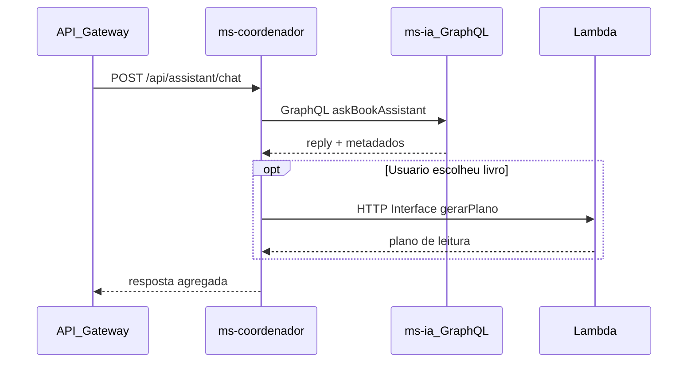
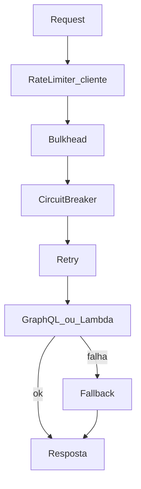

# E2 — MS1 Coordenador (`ms-coordenador`)

Em uma frase: o coordenador é a **porta de negócio** — traduz HTTP do Gateway, chama a IA via **GraphQL**, chama a Lambda via **HTTP Interface**, e concentra **resiliência + Chaos Monkey**.

---

## 1. Responsabilidades

| Faz | Não faz |
|-----|---------|
| Expor REST para o Gateway | Chamar LLM direto |
| Cliente GraphQL → `ms-ia` | Hospedar VectorStore / MCP |
| Cliente HTTP Interface → Lambda | Guardar histórico longo de chat |
| Resilience4j (retry, fallback, CB, bulkhead, rate limit cliente) | Config Server (só consome) |
| Chaos Monkey neste serviço | — |

---

## 2. Fluxo de uma requisição



---

## 3. Contratos

### REST (entrada)

`POST /api/assistant/chat`

```json
{
  "conversationId": "demo-1",
  "message": "Quero ficção científica curta",
  "gerarPlano": false,
  "livro": null
}
```

Quando `gerarPlano=true`, enviar `livro` com título/autor/páginas/dias.

### GraphQL (saída para MS2)

Ver [03-ms-ia.md](03-ms-ia.md). MS1 é **cliente**.

### HTTP Interface (saída para Lambda)

Interface Java declarativa (Spring 6 HTTP Interface), exemplo de forma:

```java
public interface PlanoLeituraClient {
  @PostExchange("/")
  PlanoLeituraResponse gerar(PlanoLeituraRequest request);
}
```

URL base vem do Config/env (`lambda.base-url`) — Twelve-Factor.

---

## 4. Resiliência (tudo no MS1)



| Padrão | Uso típico neste projeto |
|--------|---------------------------|
| Retry | Falhas transitórias ao chamar MS2/Lambda |
| Fallback | Resposta amigável (“IA indisponível, tente depois”) |
| Circuit Breaker | Abre se MS2/Lambda estiver ruim; estado no Actuator/Grafana |
| Bulkhead | Isola threads/semáforo entre chamadas IA vs Lambda |
| Rate Limiter (cliente) | Limita ritmo de saída do MS1 |
| Rate Limiter (servidor) | No **Gateway** (ver [01-plataforma.md](01-plataforma.md)) |

---

## 5. Chaos Monkey

- Ativado no MS1 (ou nas instâncias dele) na apresentação
- Injeta latência/erros/kill de beans
- Com Chaos **ligado**: erros no JMeter sobem
- Chaos **desligado** + instâncias restauradas: erros caem

Combinar com derrubar uma réplica registrada no Eureka.

---

## 6. O que a banca pede ver

| Item | Demo |
|------|------|
| GraphQL na invocação | Trace/log da mutation do MS1 → MS2 |
| HTTP Interface | Interface + chamada à Lambda |
| Distributed tracing | Mesmo `traceId` Gateway → MS1 → MS2/Lambda |
| Retry + Fallback | Forçar falha e ver fallback |
| Circuit Breaker | Abrir CB e mostrar métrica/estado |
| Rate Limiter cliente+servidor + Bulkhead | Config + comportamento sob carga |
| Chaos Monkey | Ligar/desligar durante JMeter |
