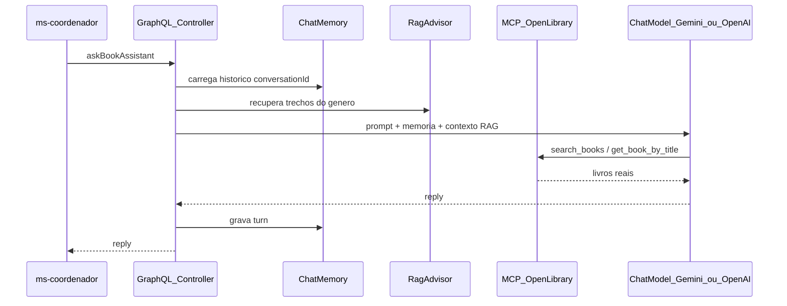
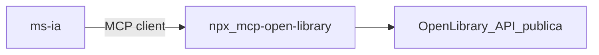
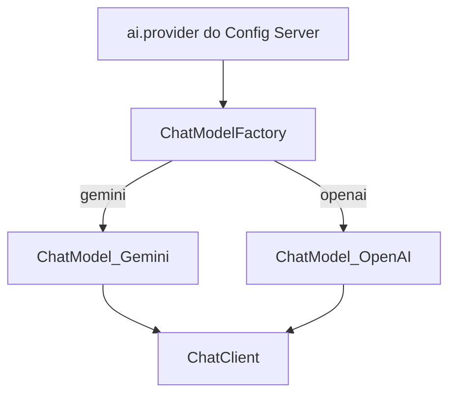

# E3 — MS2 IA (`ms-ia`)

Em uma frase: este serviço é o **cérebro** — GraphQL + Spring AI com **Chat Memory**, **RAG de gêneros**, **fábrica Gemini/OpenAI** e **MCP Open Library** (terceiro).

---

## 1. Responsabilidades

| Faz | Não faz |
|-----|---------|
| API GraphQL `askBookAssistant` | Orquestrar Lambda |
| Chat Memory por `conversationId` | Expor porta pública (só via Gateway→MS1) |
| RAG sobre `docs/corpus/` | MCP servidor próprio |
| Cliente MCP Open Library | Resilience4j completo (fica no MS1) |
| Trocar LLM via `ai.provider` | — |

---

## 2. Fluxo interno de uma pergunta



---

## 3. GraphQL

```graphql
type Query {
  health: String
}

type Mutation {
  askBookAssistant(conversationId: String!, message: String!): BookAssistantReply!
}

type BookAssistantReply {
  conversationId: String!
  reply: String!
}
```

---

## 4. Chat Memory

- Chave: `conversationId` (vindo do cliente/JMeter)
- Guarda turns user/assistant na sessão de demo
- Demo: 1ª mensagem define gênero; 2ª diz “como eu disse / mais curto” e a resposta usa o histórico

---

## 5. RAG (corpus de gêneros)

Arquivos em [`docs/corpus/`](corpus/):

| Arquivo | Conteúdo |
|---------|----------|
| `romance.md` | Características e critérios do gênero |
| `ficcao-cientifica.md` | Idem |
| `suspense.md` | Idem |
| `fantasia.md` | Idem |
| `criterios-recomendacao.md` | Regras gerais (páginas, série, etc.) |

No boot do MS2: ler Markdown → chunk → embeddings → `VectorStore` simples (memória ou SimpleVectorStore).

RAG **não** substitui o catálogo de livros; só ensina o modelo sobre gêneros.

---

## 6. MCP de terceiro — Open Library

- Pacote: [`mcp-open-library`](https://github.com/8enSmith/mcp-open-library)
- Subir: `npx -y mcp-open-library` (stdio) integrado ao Spring AI MCP client
- **Sem API key**
- Tools úteis na demo: `search_books`, `get_book_by_title`, `get_authors_by_name`



**Fora de escopo:** servidor MCP próprio.

---

## 7. Fábrica Gemini / OpenAI



- Default: **gemini**
- Troca: alterar `ai.provider` no `config-repo` + refresh (ver [01-plataforma.md](01-plataforma.md))
- Chaves só no Vault

---

## 8. O que a banca pede ver

| Item | Demo |
|------|------|
| Spring AI + LLM | Pergunta real com resposta |
| Chat Memory | Duas perguntas na mesma `conversationId` |
| RAG | Mostrar trecho recuperado / corpus |
| MCP terceiro | Tool call Open Library na resposta |
| MCP próprio | **Não aplicável neste projeto** |
| GraphQL | Mutation no playground ou log do MS1 |

---

## 9. Perguntas de demo sugeridas

1. `conversationId=demo-1`: “Quero ficção científica curta.”
2. Mesma conversa: “Algo com menos de 300 páginas, no estilo do que eu pedi.”
3. “Monte recomendações de fantasia para quem gosta de magia e mundo secundário.”
