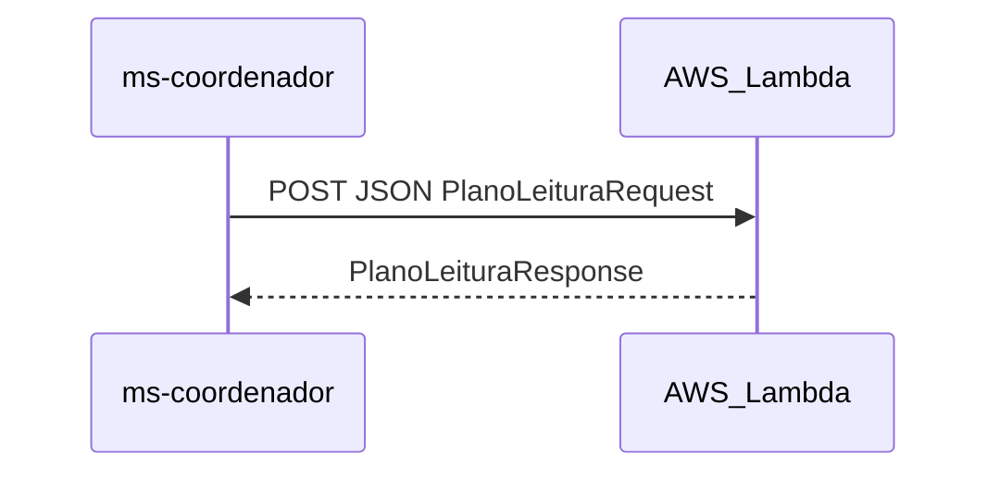

# E4 — MS3 Lambda (plano de leitura)

Em uma frase: a Lambda é uma **função curta e sem estado** que transforma JSON do livro escolhido em um **plano de leitura**.

Não há MCP próprio neste escopo.

---

## 1. Papel na arquitetura



- Invocada **sob demanda** pelo MS1 via HTTP Interface
- Sem Eureka (URL fixa / Function URL no Config)
- Ideal para carga intermitente (Twelve-Factor + serverless)

---

## 2. Contrato

### Request

```json
{
  "titulo": "Neuromancer",
  "autor": "William Gibson",
  "paginasEstimadas": 271,
  "diasDisponiveis": 14
}
```

| Campo | Tipo | Regra |
|-------|------|-------|
| `titulo` | string | obrigatório |
| `autor` | string | obrigatório |
| `paginasEstimadas` | int > 0 | obrigatório |
| `diasDisponiveis` | int > 0 | obrigatório |

### Response

```json
{
  "titulo": "Neuromancer",
  "autor": "William Gibson",
  "paginasPorDia": 20,
  "diasDisponiveis": 14,
  "checklist": [
    "Definir horário fixo de leitura",
    "Marcar progresso a cada capítulo",
    "Reservar folga no último dia para revisão"
  ],
  "mensagem": "Plano: ~20 páginas/dia em 14 dias para terminar Neuromancer."
}
```

Fórmula simples (implementação):

`paginasPorDia = ceil(paginasEstimadas / diasDisponiveis)`

---

## 3. Código no repo

Módulo `ms-lambda/`:

- `PlanoController` — HTTP local `:9000/plano` (`java -jar` para debug; **não** sobe no Compose)
- `PlanoLeituraHandler` — `RequestHandler` POJO (teste no console AWS)
- `PlanoLeituraUrlHandler` — **Function URL** (`APIGatewayV2HTTPEvent` → JSON)
- Artifact shaded: `ms-lambda-0.0.1-SNAPSHOT-aws.jar`

Handler de produção: `br.imd.ufrn.lambda.PlanoLeituraUrlHandler::handleRequest`

---

## 4. Deploy (resumo)

Ver [ambiente-aws.md](ambiente-aws.md) e [06-deploy-aws.md](06-deploy-aws.md).

1. Criar função na **conta AWS pessoal** (IAM role + Java 21)
2. Expor **Function URL** (`auth-type NONE` no lab)
3. Gravar URL em `LAMBDA_BASE_URL` (`.env` / Compose) — MS1 HTTP Interface
4. Não usar Academy/`LabRole`

---

## 5. Falhas e resiliência

Quem protege a chamada é o **MS1** (retry, CB, fallback). A Lambda só:

- Valida input (400 se inválido)
- Calcula e devolve JSON
- Não guarda estado

---

## 6. O que a banca pede ver

| Item | Demo |
|------|------|
| Lambda Server | Invocar e mostrar JSON de plano |
| HTTP Interface | Código da interface no MS1 + request real |

Fluxo de demo sugerido: após a IA sugerir um livro, chamar `POST /api/assistant/plano` (endpoint separado do chat).
