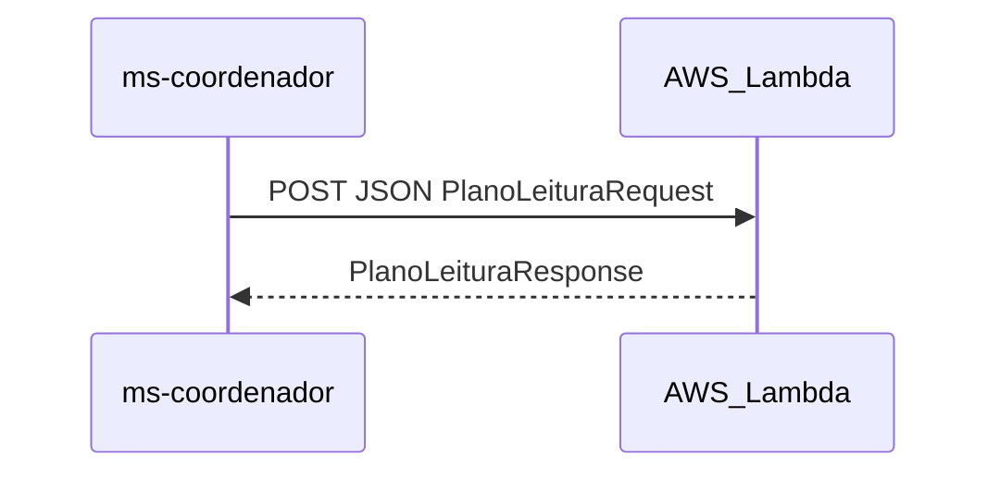

# E4 — MS3 Lambda (plano de leitura)

Em uma frase: a Lambda é uma **função curta e sem estado** que transforma JSON do livro escolhido em um **plano de leitura**.

Não há MCP próprio neste escopo.

---

## 1. Papel na arquitetura



- Invocada **sob demanda** pelo MS1 via HTTP Interface
- Sem Eureka (URL fixa / Function URL no Config)
- Ideal para carga intermitente (Twelve-Factor + serverless)

---

## 2. Contrato

### Request

```json
{
  "titulo": "Neuromancer",
  "autor": "William Gibson",
  "paginasEstimadas": 271,
  "diasDisponiveis": 14
}
```

| Campo | Tipo | Regra |
|-------|------|-------|
| `titulo` | string | obrigatório |
| `autor` | string | obrigatório |
| `paginasEstimadas` | int > 0 | obrigatório |
| `diasDisponiveis` | int > 0 | obrigatório |

### Response

```json
{
  "titulo": "Neuromancer",
  "autor": "William Gibson",
  "paginasPorDia": 20,
  "diasDisponiveis": 14,
  "checklist": [
    "Definir horário fixo de leitura",
    "Marcar progresso a cada capítulo",
    "Reservar folga no último dia para revisão"
  ],
  "mensagem": "Plano: ~20 páginas/dia em 14 dias para terminar Neuromancer."
}
```

Fórmula simples (implementação):

`paginasPorDia = ceil(paginasEstimadas / diasDisponiveis)`

---

## 3. Código no repo

Módulo `ms-lambda/`:

- Handler Java (ou função mínima) empacotável para AWS Lambda
- Teste local: stub HTTP no MS1 apontando para um mock, ou SAM/LocalStack se disponível
- Empacotamento: JAR shaded / zip conforme runtime Java da Academy

---

## 4. Deploy (resumo)

Ver detalhes em [06-deploy-aws.md](06-deploy-aws.md).

1. Criar função na AWS Academy
2. Expor **Function URL** (auth IAM ou none em lab) ou API Gateway HTTP
3. Gravar `lambda.base-url` no Config Server / env do MS1
4. MS1 chama via HTTP Interface

---

## 5. Falhas e resiliência

Quem protege a chamada é o **MS1** (retry, CB, fallback). A Lambda só:

- Valida input (400 se inválido)
- Calcula e devolve JSON
- Não guarda estado

---

## 6. O que a banca pede ver

| Item | Demo |
|------|------|
| Lambda Server | Invocar e mostrar JSON de plano |
| HTTP Interface | Código da interface no MS1 + request real |

Fluxo de demo sugerido: após a IA sugerir um livro, MS1 chama a Lambda com título/páginas/dias e devolve o plano agregado na resposta HTTP.
