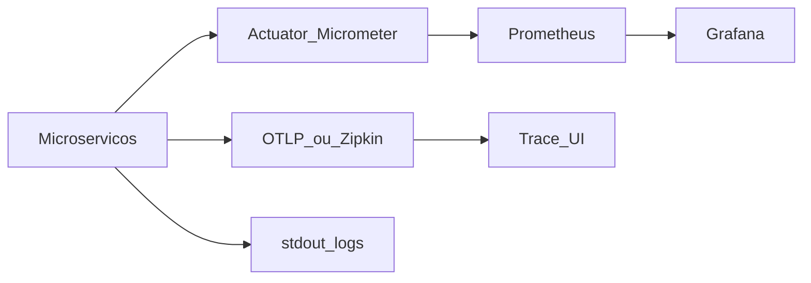

# E5 — Observabilidade, JMeter e capacidade

Em uma frase: você precisa **ver** o sistema (métricas, traces, CB) e **provar** carga com JMeter + Chaos Monkey.

---

## 1. Pilares

| Pilar | Ferramenta sugerida | O que olhar na demo |
|-------|---------------------|---------------------|
| Métricas | Actuator + Prometheus + Grafana | Taxa de erro, latência, **estado dos circuit breakers** |
| Traces | Micrometer Tracing → Zipkin/OTLP | `traceId` Gateway → MS1 → MS2 / Lambda |
| Logs | stdout / CloudWatch na AWS | Correlação com trace |

Endpoints úteis: `/actuator/health`, `/actuator/prometheus`, `/actuator/metrics`, endpoints Resilience4j se expostos.

---

## 2. JMeter

Pasta: `jmeter/`

Requisitos da banca:

1. Usuários simultâneos **> 5** e **abaixo do Knee Capacity**
2. Summary Report com **zero erros** com sistema saudável
3. Ligar Chaos Monkey / derrubar instâncias → erros **sobem**
4. Desligar Chaos / restaurar → erros **descem**
5. Grafana/Actuator mostrando CB e saúde o tempo todo

Thread group sugerido (ponto de partida):

- Target: `http://<gateway>:8080/api/assistant/chat`
- Body com `conversationId` e `message` fixos leves (evitar estourar cota LLM na medição de infra — usar stub/perfil se necessário para teste de capacidade puro)

---

## 3. Knee Capacity e Usable Capacity

Procedimento:

1. Subir usuários em degraus (5, 10, 15, …)
2. Anotar throughput, latência p95 e taxa de erro
3. **Knee**: ponto em que latência/erro sobe de forma não linear
4. **Usable Capacity**: carga sustentada com erro ~0 e latência aceitável (abaixo do knee)
5. Guardar tabela + print do Summary Report na pasta `jmeter/resultados/` (na hora da medição)

| Usuarios | Throughput | p95 ms | Erros % | Nota |
|----------|------------|--------|---------|------|
| 5 | | | | |
| 10 | | | | |
| … | | | | |

---

## 4. Chaos + observabilidade (roteiro da apresentação)

1. JMeter rodando abaixo do knee → 0 erros; Grafana verde; CB fechado
2. Ativar Chaos Monkey / matar instância → erros sobem; CB pode abrir
3. Desligar Chaos / restaurar instância no Eureka → erros caem; CB fecha
4. Mostrar trace de uma chamada GraphQL e de uma chamada Lambda

---

## 5. O que a banca pede ver

| Item | Evidência |
|------|-----------|
| Observabilidade / CB | Dashboard Grafana ou Actuator |
| Chaos Monkey | Variação da taxa de erro no JMeter |
| Retry/Fallback/CB/Rate/Bulkhead | Comportamento + métricas (detalhe no MS1) |
| Distributed tracing | UI de traces |
| Knee / Usable | Tabela preenchida + escolha de carga na demo |
