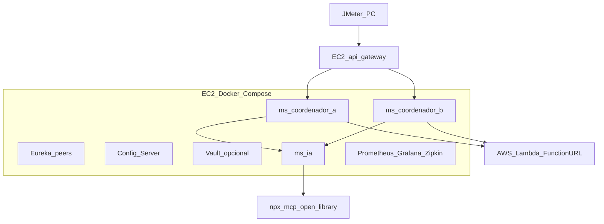

# E6 — Deploy AWS (conta pessoal)

Em uma frase: a stack Spring sobe em **1 EC2 com Docker Compose**; o plano de leitura sobe como **Lambda** (Function URL); segredos via Vault (profile) e config via Config Server.

Detalhe operacional (EIP, SG, IAM, comandos): **[ambiente-aws.md](ambiente-aws.md)**.

---

## 1. Mapa na nuvem

---

## 2. O que vai onde

| Onde | O quê |
|------|--------|
| EC2 + Compose | Eureka×2, Config, Gateway, MS1×2, MS2, obs, Vault (profile) |
| AWS Lambda | `PlanoLeituraUrlHandler` + Function URL |
| Fora | MCP próprio; 2ª EC2 (kill = `docker stop ms-coordenador-b`) |

---

## 3. Lambda

1. Build: `mvn -pl ms-lambda -am package` → `*-aws.jar`
2. Role `tp3-plano-leitura-role` + `AWSLambdaBasicExecutionRole`
3. Runtime Java 21; handler `br.imd.ufrn.lambda.PlanoLeituraUrlHandler::handleRequest`
4. Function URL (`auth NONE` no lab) → `LAMBDA_BASE_URL` no `.env`

---

## 4. Twelve-Factor (demo)

| Fator | Onde |
|-------|------|
| Config | Config Server + `config-repo` + env/`.env` |
| Segredos | Vault (`secret/ms-ia`) |
| Processos / portas | containers Compose |
| Backing services | Eureka, Vault, LLM, Lambda URL, MCP |

---

## 5. Checklist pré-apresentação

Ver [aws-checklist.md](aws-checklist.md) e [ambiente-aws.md](ambiente-aws.md).
