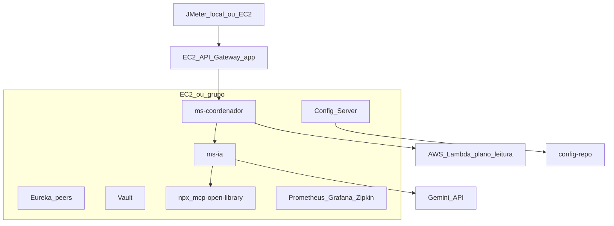

# E6 — Deploy AWS Academy

Em uma frase: a stack Spring sobe em **EC2**; a função de plano de leitura sobe como **Lambda**; segredos e config seguem Twelve-Factor.

---

## 1. Mapa na nuvem

---

## 2. O que vai em EC2

Mínimo sugerido (pode ser 1 VM grande no lab ou 2):

| Processo | Notas |
|----------|-------|
| Eureka peer A + B | Cluster |
| Config Server | Clona/`file://` do `config-repo` |
| Vault | Dev/lab com secrets LLM |
| API Gateway app | Porta pública SG liberada para JMeter |
| ms-coordenador (2+ instâncias) | Para demo de kill + Eureka |
| ms-ia | Node.js disponível para `npx mcp-open-library` |
| Prometheus + Grafana + Zipkin | Observabilidade |

Security Group: liberar só portas necessárias (8080 Gateway, 8761 Eureka UI se demo, 3000 Grafana, etc.).

---

## 3. Lambda

1. Empacotar handler de `ms-lambda`
2. Criar função Java na conta Academy
3. Function URL (ou API Gateway HTTP)
4. Colocar URL em `lambda.base-url` (Config/env do MS1)
5. Testar com um POST JSON do contrato em [04-lambda.md](04-lambda.md)

---

## 4. Segredos e config

| Dado | Onde |
|------|------|
| Gemini / OpenAI keys | Vault |
| `ai.provider` | Config Server (`config-repo`) |
| `lambda.base-url` | Config / env |
| URLs Eureka | env / config |
| Open Library | sem secret |

Nunca commitar `.env` com chaves reais.

---

## 5. Checklist pré-apresentação

- [ ] Eureka cluster com apps registrados
- [ ] Gateway respondendo na EC2
- [ ] MS2 responde GraphQL via MS1
- [ ] Memory + RAG + MCP Open Library ok
- [ ] Lambda retorna plano
- [ ] Grafana mostra CB
- [ ] JMeter salvo com carga &lt; knee e 0 erros
- [ ] Chaos Monkey pronto para ligar/desligar
- [ ] Troca `ai.provider` via Config demonstrável
- [ ] Vault com chaves válidas para o dia

---

## 6. O que a banca pede ver (deploy)

| Item | Onde |
|------|------|
| App na AWS Academy | EC2 + Lambda |
| 12 fatores | Config/env/secrets/processos/portas |
| Lambda | Function URL funcionando |
