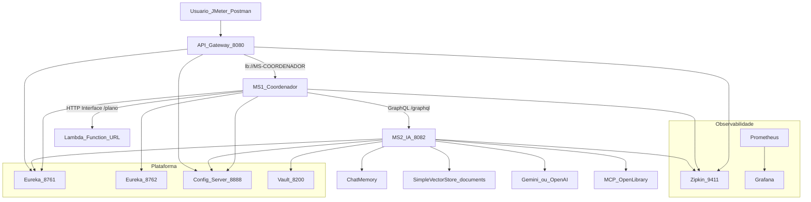
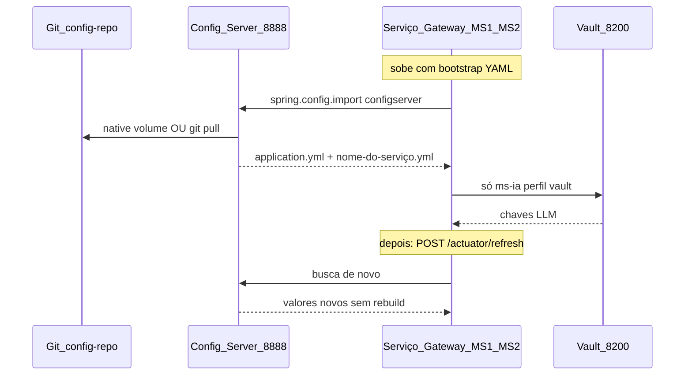

# Como funciona a config (TP3)

Roteiro para apresentar **este Markdown** na banca. Foco: configuração.  
O resto (Eureka, CB, RAG…) só entra quando ligar na config.

Complementa: [09-roteiro-apresentacao-banca.md](09-roteiro-apresentacao-banca.md) · [guia/09-yaml-linha-a-linha.md](guia/09-yaml-linha-a-linha.md)

---

## Abertura

A aplicação é um assistente de livros em microserviços Spring. O ponto central é **como a configuração chega a cada serviço** — Config Server, Git, env, Vault — **sem rebuild**.

---

## O que é a aplicação



| Peça | Papel |
|------|--------|
| API Gateway `:8080` | Entrada + rate limit; rota `lb://MS-COORDENADOR` |
| MS1 Coordenador (×2) | Orquestra + Resilience4j; chat e plano |
| MS2 IA `:8082` | Chat Memory + RAG + LLM + MCP Open Library |
| Lambda (Function URL) | Plano de leitura (fora da EC2) |
| Eureka `:8761`/`:8762` | Descoberta em cluster |
| Config Server `:8888` | YAMLs do `config-repo` (native/git) |
| Vault `:8200` | Segredos LLM |
| Zipkin / Prometheus / Grafana | Tracing e métricas |

Dois casos de uso: **chat** (GraphQL no MS-IA) e **plano** (HTTP Interface → Lambda). Em ambos, URLs, rate limit, stub de IA e limites do Resilience4j vêm da **config**, não hardcoded no Java.

---

## Ideia central: código ≠ config ≠ segredo

Twelve-Factor III (config fora do código) e IV (backing services anexáveis por URL).

| Camada | Onde | Exemplos |
|--------|------|----------|
| **Bootstrap** (no JAR) | `*/src/main/resources/application.yml` | porta, nome do app, import do Config Server |
| **Config remota** | `config-repo/*.yml` via Config Server `:8888` | `ai.stub`, rate limit, resilience4j |
| **Env / Compose** | `.env` + `docker-compose.yml` | `LAMBDA_BASE_URL`, `CONFIG_PROFILE`, Eureka |
| **Segredos** | Vault `:8200` | chaves LLM — **nunca** no Git |

O build produz a imagem; o **runtime** injeta env + Config + Vault.

---

## Cadeia completa



Na subida, cada serviço importa o Config Server. O Config junta `application.yml` + `{spring.application.name}.yml`. No MS-IA com perfil vault, as keys vêm do KV. Para mudar comportamento: editar o Git, dar refresh — sem rebuild.

---

## Config Server

Arquivo: `config-server/.../application.yml` · porta **8888**. Não é negócio: só serve YAML.

| Modo | Env | De onde lê |
|------|-----|------------|
| `native` | `CONFIG_PROFILE=native` | pasta `config-repo/` (volume no Compose) |
| `git` | `CONFIG_PROFILE=git` | GitHub do monorepo, `search-paths: config-repo` |

No deploy usamos **git** para a banca ver commit → refresh. Em native, o volume local basta. `force-pull: true` faz o pull no refresh.

**Mostrar ao vivo:** `http://<EIP>:8888/ms-ia/default` ou `/api-gateway/default`.

---

## YAMLs do `config-repo/`

```text
config-repo/
├── application.yml      → todos (health details)
├── api-gateway.yml      → rate limit servidor
├── ms-coordenador.yml   → URLs + Resilience4j + chaos flag
└── ms-ia.yml            → ai.provider / ai.stub
```

### `application.yml`

```yaml
management.endpoint.health.show-details: always
```

Health com detalhes para a demo.

### `api-gateway.yml`

```yaml
gateway.rate-limit.per-second: 40
```

Bean `@RefreshScope` `GatewayRateLimitProperties` → filtro responde **429** quando estoura.

### `ms-ia.yml`

```yaml
ai:
  provider: gemini
  stub: false   # true = resposta fake p/ JMeter; false = LLM real
```

Bean `AiProperties` `@RefreshScope`.

### `ms-coordenador.yml`

| Bloco | Função |
|-------|--------|
| `ms-ia.base-url` | nome Eureka `http://MS-IA` (load balanced) |
| `lambda.base-url` | Function URL absoluta |
| `http.client.*` | timeouts |
| `resilience4j.*` | CB / bulkhead / rate limiter **cliente** |
| `chaos.monkey.enabled` | flag remota (assaults via Actuator) |

O Java só tem anotações com **nome** (`@CircuitBreaker(name="msIa")`). Os **números** e flags vivem nestes YAMLs — por isso o refresh muda limite sem recompilar.

---

## Bootstrap vs remoto

| | Bootstrap (JAR) | Remoto (`config-repo`) |
|--|-----------------|------------------------|
| Quando | ao subir | depois do import do Config |
| Contém | porta, Eureka, `spring.config.import`, defaults | o que se muda na demo |
| Se Config cair | `optional:configserver:…` → sobe com local | — |

```yaml
spring:
  application:
    name: ms-coordenador   # define qual *-yml remoto buscar
  config:
    import: optional:configserver:${CONFIG_SERVER_URL:http://localhost:8888}
```

O `spring.application.name` liga o serviço ao arquivo remoto. `optional` evita falha total se o Config estiver fora.

---

## Env e Docker

O que **não** vai no Git de config — vai no Compose / `.env`:

| Variável | Papel |
|----------|--------|
| `EUREKA_DEFAULT_ZONE` | peers 8761/8762 |
| `CONFIG_SERVER_URL` | onde está o Config |
| `LAMBDA_BASE_URL` | Function URL AWS |
| `CONFIG_PROFILE` | `native` ou `git` |
| `VAULT_URI` / `VAULT_TOKEN` | bootstrap do Vault (ms-ia) |
| `SERVER_PORT` | 8081 vs 8083 nas réplicas |

Docker Compose é o **release/run**: imagens iguais, `.env` diferente. A Lambda é backing service — anexamos pela URL, não pelo Eureka.

---

## Vault

- UI `:8200` → KV `secret/ms-ia`
- Perfil `vault` no ms-ia; fail-fast se o Vault cair com esse perfil
- Chaves LLM / LangSmith **só** aqui

Config Server guarda **comportamento**. Vault guarda **segredo**. Na demo: mostrar a UI sem revelar o valor.

---

## Demo dinâmica

Escolher uma (ou duas se der tempo).

### Stub LLM — `ms-ia.yml`

1. GitHub: `ai.stub: true` → commit/push  
2. `curl -X POST http://<EIP>:8082/actuator/refresh`  
3. Chat com prefixo stub  
4. Voltar `stub: false` + refresh → LLM de novo  

### Rate limit — `api-gateway.yml`

1. Baixar `gateway.rate-limit.per-second` (ex.: `2`) → push  
2. `curl -X POST http://<EIP>:8080/actuator/refresh`  
3. Vários curls rápidos → **HTTP 429**  

### Resilience4j — `ms-coordenador.yml`

1. Alterar `limitForPeriod` / bulkhead → push  
2. Refresh nos **dois** coordenadores (`:8081` e `:8083`)  
3. Conferir Actuator `ratelimiters` / `bulkheads`  

**Fechamento da demo:** commit no Git → Config Server lê → `/actuator/refresh` → beans `@RefreshScope` atualizam. Sem rebuild, sem redeploy da imagem.

---

## O que não confundir

| Não | Sim |
|-----|-----|
| Eureka = config | Eureka = **descoberta** de instâncias |
| Lambda “no Config” como serviço | Só a **URL** (`lambda.base-url`); função na AWS |
| Refresh = reiniciar container | Refresh = relê propriedades |
| Tudo no `config-repo` | Segredos no Vault; infra no `.env` |

---

## Fecho

Com a config clara: Gateway usa rate do YAML; MS1 usa resilience do YAML; MS2 usa stub/provider do YAML; Lambda e LLM são backing services por URL/credencial. O resto da banca — Eureka, Zipkin, Chaos, JMeter — mostra essa config sob carga e falha.

**Docker (se perguntarem):** um Compose sobe plataforma + obs na EC2; Vault opcional; Lambda fora, só URL no env.

**12 fatores (se perguntarem):** I monorepo · III Config/env · IV backing services · V build ≠ run · VIII 2× coordenador · IX stop/start · X Compose ≈ EC2 · XII refresh/Vault CLI.

---

## Comandos na banca (parar / ligar / checar)

Elastic IP atual: **`77.114.59.85`**.  
No browser / curls do PC → use o EIP. Na própria VM → use `127.0.0.1`.  
`docker stop` / `docker start` só na EC2 (via SSH).

### Conectar na EC2 (PowerShell no PC)

```powershell
# 1) Permissão da chave (só se o SSH reclamar de "UNPROTECTED PRIVATE KEY")
$k = "c:\Users\mayco\OneDrive\Documentos\UF\api-gateway\my-key.pem"
icacls.exe $k /reset
icacls.exe $k /GRANT:R "$($env:USERNAME):R"
icacls.exe $k /inheritance:r

# 2) Entrar na máquina
ssh -i $k ec2-user@77.114.59.85
```

Uma linha (se a chave já estiver ok):

```powershell
ssh -i "c:\Users\mayco\OneDrive\Documentos\UF\api-gateway\my-key.pem" ec2-user@77.114.59.85
```

Depois do login: `cd ~/ai-powered-web-application` e os `docker …` abaixo.

### Quem é quem (containers)

| Container | Porta | O que prova ao parar |
|-----------|-------|----------------------|
| `ms-coordenador-b` | 8083 | Eureka: some uma réplica; carga segue na `a` |
| `ms-coordenador-a` | 8081 | idem (não mate as duas se quiser chat vivo) |
| `ms-ia` | 8082 | CB `msIa` abre + fallback no chat |
| `api-gateway` | 8080 | entrada cai (só se pedirem) |
| `config-server` | 8888 | refresh falha; apps já subiram continuam com config em memória |
| `eureka1` / `eureka2` | 8761/8762 | peer restante; discovery degrada |
| `vault` | 8200 | ms-ia com perfil vault: fail-fast no **restart**; não mate sem avisar |

### Parar / religar (na EC2)

```bash
# Listar
docker ps --format "table {{.Names}}\t{{.Status}}\t{{.Ports}}"

# Kill réplica (Eureka) — preferir a b
docker stop ms-coordenador-b
# Ver em http://<EIP>:8761 → MS-COORDENADOR só 1 instância (~15s)
docker start ms-coordenador-b

# Kill MS-IA (Circuit Breaker + fallback)
docker stop ms-ia
# Chat ainda 200 com texto de fallback; :8081/actuator/circuitbreakers → msIa OPEN
docker start ms-ia
# Esperar ~20s; HALF_OPEN → CLOSED

# Não mate o Gateway / as duas réplicas / o Config sem necessidade
# docker stop api-gateway
# docker stop ms-coordenador-a ms-coordenador-b
```

### Chaos Monkey (coordenadores)

```bash
curl -s http://127.0.0.1:8081/actuator/chaosmonkey/status
curl -X POST http://127.0.0.1:8081/actuator/chaosmonkey/enable
curl -X POST http://127.0.0.1:8083/actuator/chaosmonkey/enable
# gerar carga (JMeter / curls) → erros/latência sobem

curl -X POST http://127.0.0.1:8081/actuator/chaosmonkey/disable
curl -X POST http://127.0.0.1:8083/actuator/chaosmonkey/disable
```

### Refresh de config (do PC ou da EC2)

```bash
curl -X POST http://<EIP>:8082/actuator/refresh   # ms-ia (ai.stub)
curl -X POST http://<EIP>:8080/actuator/refresh   # gateway (rate limit)
curl -X POST http://<EIP>:8081/actuator/refresh   # coordenador a
curl -X POST http://<EIP>:8083/actuator/refresh   # coordenador b
```

### Smoke: chat, plano, saúde

```bash
# Chat
curl -s -X POST http://<EIP>:8080/api/assistant/chat \
  -H "Content-Type: application/json" \
  -d "{\"conversationId\":\"banca-1\",\"message\":\"Quero ficcao cientifica curta\"}"

# Plano (Lambda)
curl -s -X POST http://<EIP>:8080/api/assistant/plano \
  -H "Content-Type: application/json" \
  -d "{\"titulo\":\"Neuromancer\",\"autor\":\"William Gibson\",\"paginasEstimadas\":271,\"diasDisponiveis\":14}"

# Circuit breakers / health
curl -s http://<EIP>:8081/actuator/circuitbreakers
curl -s http://<EIP>:8081/actuator/health
curl -s http://<EIP>:8082/actuator/health
```

### UIs rápidas

| O quê | URL |
|-------|-----|
| Eureka | `http://<EIP>:8761` |
| GraphiQL | `http://<EIP>:8082/graphiql` |
| Zipkin | `http://<EIP>:9411` |
| Grafana | `http://<EIP>:3000` (`admin`/`admin`) |
| Vault | `http://<EIP>:8200` |
| Demo chat | `http://<EIP>:8080/demo/` |
| Config (ms-ia) | `http://<EIP>:8888/ms-ia/default` |

### Ordem se o professor pedir “derruba X”

1. **Réplica** → `docker stop ms-coordenador-b` → Eureka  
2. **IA** → `docker stop ms-ia` → chat + CB + fallback  
3. **Chaos** → enable nos dois coordenadores → JMeter  
4. Sempre religar no fim: `docker start …` / chaos `disable`

---

## Checklist

```text
[ ] CONFIG_PROFILE=git no .env de deploy
[ ] :8888/ms-ia/default e :8888/api-gateway/default abrem
[ ] AiProperties / GatewayRateLimitProperties com @RefreshScope
[ ] Demo stub ou rate limit ensaiada (push + refresh + efeito)
[ ] Se resilience: refresh em 8081 e 8083
[ ] Vault UI aberta sem mostrar key
[ ] LAMBDA_BASE_URL no .env (plano 200)
```

## Ordem na banca

1. App + ideia (código ≠ config ≠ segredo)  
2. Cadeia + Config Server + YAMLs  
3. **Demo refresh**  
4. Vault  
5. Depois: Eureka, Lambda, CB/Grafana, JMeter  
