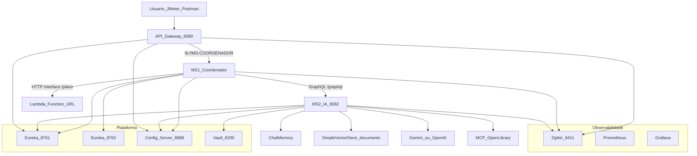

# 2. Mapa do sistema

---

## 2.1 O diagrama



Fluxo feliz do chat: usuário → Gateway (rate limit) → MS1 (resiliência) → MS2 (memory + RAG tool + LLM/MCP) → resposta JSON com campo `response`.

Fluxo do plano (separado): usuário → Gateway → MS1 `POST /api/assistant/plano` → Lambda → `PlanoLeituraDto`.

> **Por que assim?** · [D08](../DECISOES.md) · [D09](../DECISOES.md) · [D13](../DECISOES.md)  
> Chat e plano são UCs diferentes; GraphQL não carrega DTO da Lambda.

---

## 2.2 Os módulos (Maven)

```text
ai-powered-web-application/
├── pom.xml                 # parent
├── eureka-server/          # discovery (2 peers)
├── config-server/          # configs versionadas
├── api-gateway/            # Spring Cloud Gateway + rate limit
├── ms-coordenador/         # MS1: orquestra + Resilience4j
├── ms-ia/                  # MS2: Spring AI + GraphQL + RAG
├── ms-lambda/              # código empacotado como Function
├── chat-demo/              # cliente CLI opcional
├── config-repo/            # YAML consumido pelo Config Server
├── docs/                   # documentação + este guia
├── jmeter/                 # planos de carga
└── observability/          # Prometheus / Grafana
```

> **Por que assim?** · [D01](../DECISOES.md)  
> Monorepo: um clone, um Compose, Config Server apontando `config-repo/` no mesmo Git.

**Não existe** módulo de servidor MCP próprio — só cliente Open Library ([D10](../DECISOES.md)).

---

## 2.3 Como a configuração chega a cada serviço

1. **Env / Compose** — `CONFIG_SERVER_URL`, `EUREKA_DEFAULT_ZONE`, `LAMBDA_BASE_URL`, `VAULT_URI`, `ZIPKIN_ENDPOINT`, …
2. **Config Server** — `GET /{application}/{profile}` junta `application.yml` + `{nome}.yml` do `config-repo` (ou Git com `search-paths: config-repo`).
3. **Vault** (ms-ia, perfil `vault`) — KV `secret/ms-ia` → propriedades Spring (chaves LLM).
4. **Eureka** — após configurado, o serviço registra IP/porta e renova o lease (~5s). Quem chama usa `lb://NOME`.

Arquivos vivos no Git de config:

| Arquivo | Quem consome | Exemplos de chave |
|---------|--------------|-------------------|
| `config-repo/application.yml` | todos | health details |
| `config-repo/ms-ia.yml` | MS-IA | `ai.stub`, `ai.provider` |
| `config-repo/api-gateway.yml` | Gateway | `gateway.rate-limit.per-second` |
| `config-repo/ms-coordenador.yml` | MS1 | `ms-ia.base-url`, resilience4j, timeouts |

---

## 2.4 Onde roda cada coisa

| Peça | Local típico (EC2 Compose) | AWS “pura” |
|------|----------------------------|------------|
| Eureka, Config, Gateway, MS1×2, MS2 | containers na EC2 | — |
| Vault | container `:8200` | — |
| Zipkin / Prometheus / Grafana | containers | — |
| Plano de leitura | — | **Lambda** + Function URL |
| LLM / embeddings | APIs externas (Gemini/OpenAI) | — |
| MCP Open Library | processo `npx` no container ms-ia | — |

> **Por que assim?** · [D19](../DECISOES.md)  
> Um único host para a demo da banca; só o MS3 é serverless de verdade.

Detalhes de deploy: [docs/06-deploy-aws.md](../06-deploy-aws.md), [docs/ambiente-aws.md](../ambiente-aws.md).

---

Próximo: [3. Uma requisição pelo código](03-request-pelo-codigo.md).
