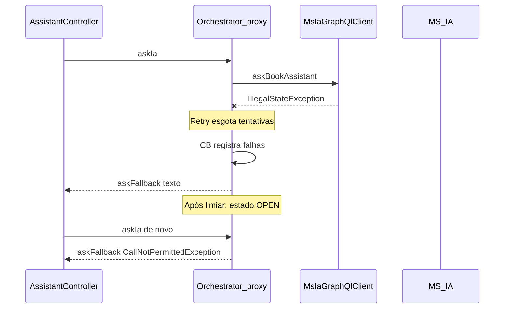

# 6. Resiliência em detalhe

---

## 6.1 Todas as instâncias Resilience4j

Cada anotação aponta para uma instância pelo **nome**. Parâmetros estão no YAML do coordenador (bootstrap + Config).

| Instância | Métodos | Retry | CircuitBreaker | RateLimiter | Bulkhead |
|-----------|---------|-------|----------------|-------------|----------|
| `msIa` | `askIa` | 3 × 500ms | janela 10, falha 50%, open 5s | 15/s, timeout 0 | max 8 |
| `lambda` | `gerarPlano` | 2 × 300ms | idem | 10/s, timeout 0 | max 4 |

`timeoutDuration: 0` no rate limiter cliente = se não houver permissão na hora, falha na hora (não enfileira).

Além disso, no **Gateway**, rate limit **servidor** independente: 40/s por IP ([D05](../DECISOES.md)).

---

## 6.2 Ordem dos aspectos

No `AssistantOrchestrator`, as anotações empilhadas são:

```java
@RateLimiter(name = "msIa")
@Bulkhead(name = "msIa")
@CircuitBreaker(name = "msIa", fallbackMethod = "askFallback")
@Retry(name = "msIa")
public String askIa(...) { ... }
```

Leitura prática (de fora para dentro, alinhada ao Resilience4j Spring Boot):

1. **RateLimiter** — limita taxa de entrada no método.
2. **Bulkhead** — limita concorrência.
3. **CircuitBreaker** — se OPEN, nem tenta; se CLOSED, observa falhas.
4. **Retry** — repete a chamada ao cliente GraphQL em falhas transitórias.
5. **Método real** — `msIaGraphQlClient.askBookAssistant`.

O **`fallbackMethod`** está no CircuitBreaker: quando o CB abre (ou a chamada falha e o CB decide), `askFallback` devolve string amigável. O controller continua respondendo HTTP 200 com essa string.

Pontos de atenção:

- Chamada `this.askIa` **dentro** da mesma classe **não** passa pelo proxy — por isso o controller usa outro bean.
- Recusas locais (`CallNotPermittedException`, bulkhead cheio) não devem ser “remediadas” por retry infinito; a config padrão do projeto deixa o fallback responder.

---

## 6.3 Caminho da exceção até o fallback



Evidência EC2: [docs/10 §5](../10-resultados-pos-refatoracao-2026-11-26.md).

---

## 6.4 Rate limiter do Gateway

`InMemoryRateLimitFilter`:

- Chave = `X-Forwarded-For` (primeiro IP) ou remote address.
- Janela deslizante grosseira de 1s (`Window.startMs`).
- Estouro → **429** sem encaminhar ao MS1.

Não é Redis: o limite é **por processo** do Gateway. Com uma instância de Gateway na demo, isso basta.

> **Por que assim?** · [D04](../DECISOES.md)

---

## 6.5 Orçamento de tempo

Timeouts HTTP do coordenador (`http.client`):

| Chave | Default | Papel |
|-------|---------|-------|
| `connect-timeout` | 3s | TCP/conectar |
| `read-timeout` | 45s | corpo (LLM pode demorar) |

Aplicados no `RestClient` load-balanced (MS-IA) e no cliente da Lambda (`HttpClientsConfig`).

No MS-IA, `BookAssistantService.callWithTransientRetry` ainda faz até 3 tentativas com sleep 1,5s × tentativa em erros tipo 503/high demand — isso é **retry de aplicação** em cima do LLM, separado do Resilience4j do MS1.

---

## 6.6 Onde cada padrão aparece

| Padrão | Gateway | MS1 msIa | MS1 lambda | MS2 |
|--------|---------|----------|------------|-----|
| Rate limit | sim (servidor) | sim (cliente) | sim | — |
| Bulkhead | — | sim | sim | — |
| Circuit breaker | — | sim | sim | — |
| Retry | — | sim | sim | retry LLM local |
| Fallback | 429 | `askFallback` | `planoFallback` | stub se sem client |

---

Próximo: [7. 12 fatores, AWS e capacidade](07-doze-fatores-e-aws.md).
