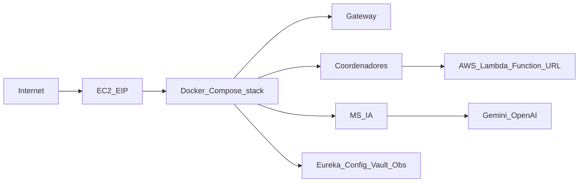

# 7. 12 fatores, AWS e capacidade

---

## 7.1 Twelve-Factor (detalhe)

| # | Fator | Como suportamos | Onde mostrar |
|---|-------|-----------------|--------------|
| I | Codebase | Um Git monorepo | raiz do repo |
| II | Dependencies | `pom.xml` por módulo; Node só para MCP via `npx` | poms; `application.yml` MCP |
| III | Config | Config Server + env; **nunca** key no Git | `config-repo/`, Vault |
| IV | Backing services | URLs/creds anexáveis | Eureka, Vault, LLM, Lambda URL, Zipkin |
| V | Build/release/run | Maven/Docker build ≠ `.env` de runtime | `scripts/docker-up*.sh` |
| VI | Processes | Containers stateless; memória de chat em processo (demo) / Memory API | Compose |
| VII | Port binding | Portas fixas por serviço | YAMLs `server.port` |
| VIII | Concurrency | Escala horizontal do MS1 (2 réplicas) | Eureka + kill `ms-coordenador-b` |
| IX | Disposability | Stop/start rápido; Chaos | Compose + Actuator |
| X | Dev/prod parity | Mesmo Compose na EC2 | `docs/ambiente-aws.md` |
| XI | Logs | stdout; métricas Prometheus; traces Zipkin | Grafana TP3 |
| XII | Admin | refresh, Vault CLI, scripts de deploy | `/actuator/refresh` |

Visão curta também em [docs/00-visao-geral.md](../00-visao-geral.md).

---

## 7.2 AWS neste trabalho

Arquitetura escolhida ([D19](../DECISOES.md)):

- **EC2:** toda a plataforma Spring + observabilidade.
- **Lambda:** só o plano de leitura (`ms-lambda` empacotado).
- **Segredos:** Vault na EC2 (não Secrets Manager neste TP).
- Checklist: [docs/aws-checklist.md](../aws-checklist.md), passo a passo [docs/ambiente-aws.md](../ambiente-aws.md).

Não há multi-AZ nem ECS neste escopo — a banca pede demonstrar Cloud + resiliência, não um design de produção completo.

---

## 7.3 Capacidade (o que os testes disseram)

Comparar sempre **dois** documentos:

| Doc | Contexto |
|------|----------|
| [08-resultados-testes.md](../08-resultados-testes.md) | Baseline anterior |
| [10-resultados-pos-refatoracao-2026-11-26.md](../10-resultados-pos-refatoracao-2026-11-26.md) | Pós-refatoração, rate **40**/s |

Síntese da rodada 2026-11-26 (stub, JMeter `assistant-chat.jmx`):

| Usuários | Throughput / erros (aprox.) | Leitura |
|----------|----------------------------|---------|
| 5 | ~16,7/s · 0% | confortável |
| 8 | poucos erros (~1,5%) | ainda usável |
| 12 | ~8% erros (429) | knee / saturação do rate servidor |

Circuit breaker: stop `ms-ia` → OPEN + fallback 200; start → HALF_OPEN → recuperação.

Gargalo consciente na demo: **rate limit do Gateway** (proteção) antes de CPU da EC2. Bulkhead do MS1 (8 chamadas) limita pressão no MS-IA.

> **Por que assim?** · [D05](../DECISOES.md) · [D14](../DECISOES.md)

---

## 7.4 O que não está no guia (de propósito)

- Gerador automático de PDF (o amigo do Tutor PD tem `scripts/gerar-guia.sh`; aqui os trechos são manuais).
- Reescrever `docs/00`–`10` — eles continuam a documentação “oficial” de produto/banca.

---

Parte 2: [8. Fichas por classe](08-fichas-classes.md).
